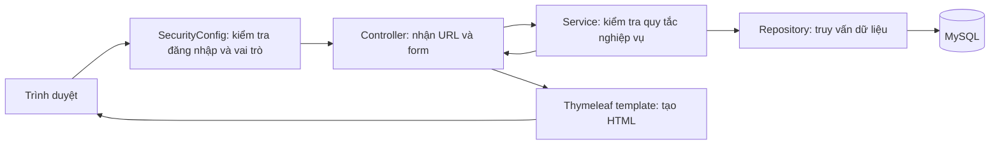

# Hướng dẫn đọc code và hiểu luồng website

Tài liệu này dành cho người mới học Spring Boot. Mục tiêu là giúp bạn hiểu một yêu cầu từ trình duyệt đi qua những file nào, dữ liệu nằm ở đâu và từng vai trò làm gì. Tài liệu giải thích code hiện có; việc một chức năng có file code chưa đồng nghĩa luồng đó đã được kiểm thử đầy đủ.

## 1. Nhìn tổng thể ứng dụng

Website dùng **Spring Boot + Spring MVC + Thymeleaf + MySQL**. Trình duyệt gửi yêu cầu đến máy chủ Java; máy chủ kiểm tra đăng nhập và quyền, đọc hoặc ghi dữ liệu MySQL, rồi trả về một trang HTML.



Ví dụ: sinh viên nhấn **Tham gia nhóm**. Trình duyệt gửi request; controller nhận mã nhóm và tài khoản đang đăng nhập; service kiểm tra sinh viên đã ở nhóm khác chưa và nhóm còn chỗ không; repository lưu thành viên vào MySQL; website chuyển về trang nhóm và hiện thông báo.

## 2. Mỗi thư mục làm nhiệm vụ gì?

| Vị trí | Cách hiểu đơn giản | Ví dụ |
|---|---|---|
| `config/` | Cấu hình dùng chung, đặc biệt là bảo mật | `SecurityConfig.java` |
| `controller/` | Nhận URL/form, gọi service, chọn trang trả về | `StudentGroupController.java` |
| `service/` | Chứa quy tắc nghiệp vụ | `StudentPortalService.java` |
| `repository/` | Đọc và ghi dữ liệu MySQL | `GroupMemberRepository.java` |
| `entity/` | Lớp Java đại diện dữ liệu được lưu | `StudentGroup.java`, `User.java` |
| `dto/` | Gói dữ liệu trung gian cho form hoặc trang | `StudentGroupView.java` |
| `resources/templates/` | Các trang HTML Thymeleaf | `student/groups/list.html` |
| `resources/static/` | CSS, JavaScript, hình ảnh | `static/css/style.css` |
| `application.properties` | Cấu hình database, JPA và nơi lưu file | `resources/application.properties` |
| `database/` | Script SQL và migration | `migrations/002_add_reviewer_scores.sql` |

### Cách đọc một chức năng

1. Tìm URL trong controller, ví dụ `@RequestMapping("/student/groups")`.
2. Xem controller gọi hàm nào trong service.
3. Đọc service để hiểu điều kiện nghiệp vụ.
4. Xem repository và entity để hiểu dữ liệu nào được đọc/ghi.
5. Mở template mà controller trả về để xem form/bảng giao diện.

Controller trả `return "student/groups/list";` thì Spring tìm file `resources/templates/student/groups/list.html`.

## 3. MVC bằng một ví dụ

Đường dẫn `/student/registrations` có hai thao tác:

- **GET** mở trang. `StudentRegistrationController` lấy nhóm, đăng ký cũ và đề tài có thể chọn; template hiển thị dữ liệu.
- **POST** gửi đề tài đã chọn. Controller gọi `StudentPortalService.registerTopic(...)`. Service kiểm tra người gửi có phải nhóm trưởng không, đề tài đã công bố chưa và đợt có đang trong thời gian nhận đăng ký sinh viên không. Nếu hợp lệ, đăng ký được lưu ở trạng thái chờ duyệt.

Tóm tắt: **Controller điều phối request; Service quyết định nghiệp vụ; Repository làm việc với database; Entity biểu diễn dữ liệu; Template hiển thị giao diện.** Không nên đặt toàn bộ quy tắc nghiệp vụ trong HTML.

## 4. Các vai trò

### Quản trị viên — ADMIN
- Tạo, sửa, khóa/mở khóa và xóa tài khoản trong phạm vi dữ liệu cho phép.
- Quản lý thông báo.
- Xem hồ sơ và đổi mật khẩu của chính mình.

### Trưởng khoa — HEAD
- Tạo, mở, đóng và quản lý đợt đăng ký.
- Duyệt/từ chối và công bố đề tài giảng viên gửi.
- Duyệt/từ chối đăng ký đề tài của nhóm sinh viên.
- Phân công giảng viên phản biện.
- Tạo hội đồng, thêm thành viên, xếp đề tài và công bố kết quả.
- Quản lý thông báo.

### Giảng viên — LECTURER
- Gửi đề tài trong giai đoạn được đăng ký; người gửi là GVHD chính và có thể chọn thêm một GVHD.
- Xem/tải báo cáo của nhóm mình hướng dẫn.
- Xem nhiệm vụ phản biện, tải báo cáo được giao, nhập điểm và nhận xét trước hạn.
- Nếu là thành viên hội đồng, chấm các đề tài được giao trong hội đồng.

### Sinh viên — STUDENT
- Tạo nhóm hoặc tham gia nhóm đang nhận thành viên.
- Nhóm trưởng đăng ký đề tài đã công bố và theo dõi trạng thái.
- Nhóm trưởng nộp báo cáo; thành viên cùng nhóm có thể tải báo cáo.
- Xem kết quả đã công bố cho đề tài của nhóm.

## 5. Luồng nghiệp vụ từ đầu đến cuối

```mermaid
sequenceDiagram
    participant H as Trưởng khoa
    participant L as Giảng viên
    participant S as Sinh viên/nhóm trưởng
    participant R as GVPB
    participant C as Hội đồng
    H->>H: Tạo đợt, thiết lập thời gian và mở đợt
    L->>H: Gửi đề tài kèm 1 hoặc 2 GVHD
    H->>L: Duyệt/từ chối rồi công bố đề tài được duyệt
    S->>H: Nhóm trưởng đăng ký đề tài đã công bố
    H->>S: Duyệt/từ chối đăng ký của nhóm
    S->>R: Nhóm trưởng nộp báo cáo sau khi được duyệt
    H->>R: Phân công giảng viên phản biện
    R->>H: Nộp điểm phản biện và nhận xét
    H->>C: Lập hội đồng và xếp đề tài đủ điều kiện
    C->>C: Thành viên chấm; chủ tịch tổng hợp điểm
    H->>S: Công bố kết quả để sinh viên xem
```

### Bước 1 — Trưởng khoa tạo đợt

`RegistrationPeriodService` kiểm tra các mốc thời gian. Đợt có hai cửa sổ riêng: đăng ký đề tài của giảng viên và đăng ký đề tài của sinh viên. Đợt TLCN/KLTN cần hạn nộp điểm phản biện; KLTN cần thêm ngày báo cáo hội đồng. Đợt được tạo ở trạng thái nháp, sau đó Trưởng khoa mở đợt.

### Bước 2 — Giảng viên gửi đề tài

`TopicService` kiểm tra đợt đang mở đúng cửa sổ giảng viên, bộ môn hợp lệ và GVHD thứ hai (nếu có) là giảng viên đang hoạt động, khác GVHD chính. Đề tài mới ở trạng thái chờ duyệt. Trưởng khoa có thể duyệt, từ chối hoặc công bố đề tài đã duyệt.

### Bước 3 — Sinh viên lập nhóm và đăng ký

`StudentPortalService` quản lý nhóm. Theo các kiểm tra trong code, một sinh viên chỉ thuộc một nhóm, nhóm tối đa ba người; nhóm không nhận thêm người sau khi đã đăng ký. Chỉ nhóm trưởng đăng ký đề tài. Nếu đăng ký bị từ chối, nhóm có thể chọn lại và gửi đăng ký mới. Trưởng khoa duyệt đăng ký của nhóm.

### Bước 4 — Nộp báo cáo và phản biện

`StudentReportService` chỉ cho nhóm trưởng nộp báo cáo sau khi đăng ký đề tài đã được duyệt. File giới hạn 10 MB và nhận PDF/DOC/DOCX; file được lưu trong thư mục cấu hình `app.upload.report-dir` (mặc định `uploads/reports`). `ReviewerService` cho Trưởng khoa phân công GVPB và cho giảng viên được giao nhập điểm 0–10 cùng nhận xét trước hạn. GVHD không được phân công phản biện đề tài của mình.

### Bước 5 — Hội đồng và điểm cuối

Trưởng khoa tạo hội đồng nháp, thêm từ 3 đến 5 giảng viên (gồm đúng một chủ tịch và một thư ký), rồi xếp đề tài đủ điều kiện. Theo service, đề tài cần có báo cáo và đủ điểm phản biện mới được xếp. Thành viên hội đồng nhập điểm; GVHD không được chấm đề tài mình hướng dẫn. Khi các thành viên đủ điều kiện đã chấm, chủ tịch tổng hợp điểm trung bình, nhận xét và kết quả. Trưởng khoa thực hiện bước công bố cuối cùng.

## 6. Các bảng database quan trọng

| Bảng/entity | Ý nghĩa |
|---|---|
| `users` / `User` | Tài khoản, vai trò, thông tin giảng viên/sinh viên, trạng thái |
| `departments` / `Department` | Bộ môn |
| `registration_periods` / `RegistrationPeriod` | Đợt và các mốc thời gian |
| `topics` / `Topic` | Đề tài, bộ môn, đợt và trạng thái |
| `topic_supervisors` / `TopicSupervisor` | Các giảng viên hướng dẫn của đề tài |
| `student_groups` / `StudentGroup` | Nhóm và nhóm trưởng |
| `group_members` / `GroupMember` | Liên kết sinh viên với nhóm |
| `topic_registrations` / `TopicRegistration` | Nhóm đăng ký đề tài và trạng thái duyệt |
| `reports` / `Report` | Thông tin file báo cáo của đăng ký |
| `topic_reviewers` / `TopicReviewer` | Phân công GVPB, điểm và nhận xét phản biện |
| `councils`, `council_members`, `council_topics` | Hội đồng, thành viên, đề tài trong hội đồng |
| `scores` / `Score` | Điểm và nhận xét của từng thành viên hội đồng |
| `results` / `Result` | Điểm/kết luận cuối cùng và trạng thái công bố |
| `announcements` / `Announcement` | Thông báo và đối tượng được xem |

Một nhóm và một đề tài được nối qua `topic_registrations`. Điểm GVPB được lưu trong `topic_reviewers`; điểm thành viên hội đồng được lưu trong `scores`; kết quả cuối lưu trong `results`. Đây là ba phần dữ liệu khác nhau.

## 7. Đăng nhập và bảo mật

`SecurityConfig.java` khai báo quyền URL: `/admin/**` cho ADMIN; `/head/**` và `/periods/**` cho HEAD; `/lecturer/**` cho LECTURER; `/student/**` cho STUDENT. Spring Security kiểm tra đăng nhập; mật khẩu tài khoản được mã hóa BCrypt trước khi lưu.

Menu ẩn/hiện nút theo vai trò chỉ giúp giao diện dễ dùng. **Quyền thật vẫn phải được kiểm tra ở máy chủ**; không dựa riêng vào việc người dùng có nhìn thấy nút hay không.

## 8. Cấu hình để chạy trên máy

Trong `application.properties`, cấu hình kết nối đọc từ biến môi trường `DB_URL`, `DB_USERNAME`, `DB_PASSWORD`. Mỗi thành viên dùng database và mật khẩu MySQL của máy họ; không ghi mật khẩu vào GitHub. `spring.jpa.hibernate.ddl-auto=none` nghĩa là Hibernate không tự tạo bảng: cần chạy SQL khởi tạo database trước.

Báo cáo lưu trên ổ đĩa của máy đang chạy ứng dụng. Khi triển khai hosting, cần kiểm tra nơi lưu file có tồn tại bền vững hay không.

**Ghi chú khi viết tài liệu:** thư mục `database/` trong repository hiện có migration `002_add_reviewer_scores.sql` và `reset_demo_data_keep_admin.sql`, chưa thấy file SQL tạo toàn bộ schema. Cần bổ sung/kiểm tra file schema trước khi thành viên khác dựng database. Script `reset_demo_data_keep_admin.sql` xóa dữ liệu nghiệp vụ; chỉ chạy khi chủ động đặt lại dữ liệu demo và đã kiểm tra đúng database.

## 9. Khi sửa code theo nhóm

- Trước khi sửa, lấy code mới nhất bằng GitHub Desktop: **Fetch origin**, sau đó **Pull origin**.
- Mỗi thành viên làm trên branch riêng; commit thay đổi liên quan rồi push branch/Pull Request.
- Tránh hai người cùng sửa một template hoặc `style.css` một lúc; thống nhất ai phụ trách file nào.
- Khi báo lỗi, ghi URL, vai trò đăng nhập, thao tác vừa làm và lỗi ở Terminal/Debug Console.
- Sau khi ghép code, thử luồng với dữ liệu demo. Test hiện có chủ yếu là `contextLoads()`, chưa thay thế việc kiểm tra nghiệp vụ từng vai trò.

## 10. Từ điển thuật ngữ nhanh

- **Controller:** nhận yêu cầu từ trình duyệt.
- **Service:** kiểm tra quy tắc nghiệp vụ.
- **Repository:** đọc/ghi database.
- **Entity:** lớp Java đại diện dữ liệu được lưu.
- **DTO:** gói dữ liệu trung gian cho form/trang.
- **Template:** HTML Thymeleaf được máy chủ điền dữ liệu.
- **Migration:** SQL thay đổi database theo phiên bản.
- **Commit:** lưu một mốc thay đổi trong lịch sử Git.
- **Push/Pull:** gửi thay đổi lên GitHub / lấy thay đổi từ GitHub về máy.
- **Branch:** nhánh làm việc riêng, tránh sửa trực tiếp `main`.

