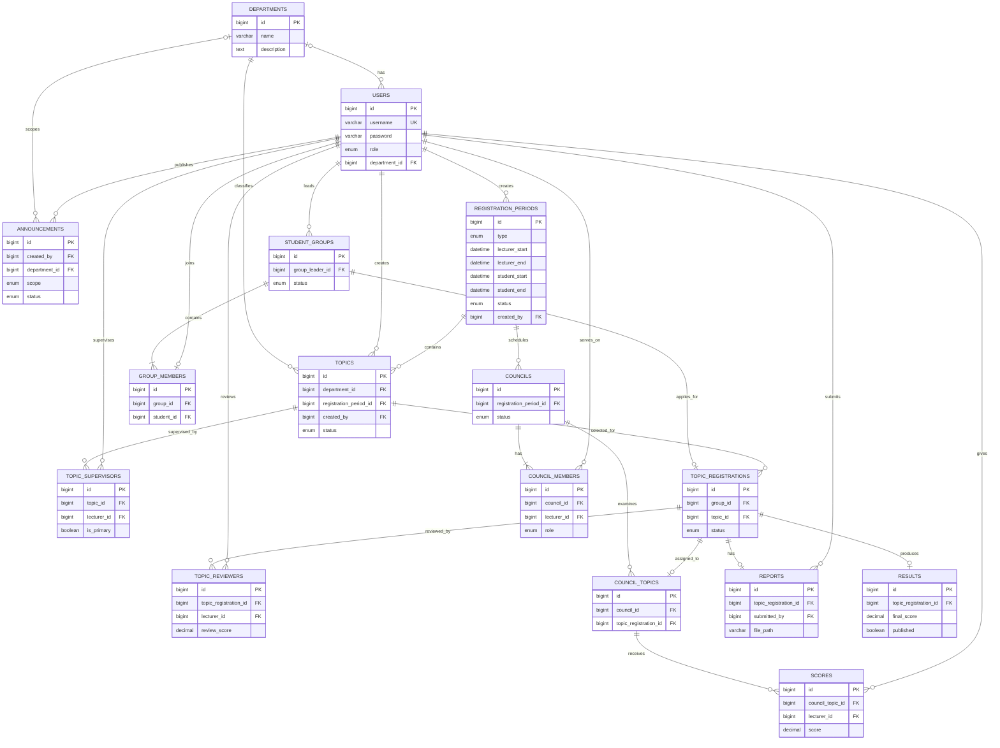

# ERD và từ điển dữ liệu

Tài liệu này mô tả schema `student_topic_management` trong `student_topic_management_v2.sql`. SQL là nguồn chuẩn về kiểu cột, enum, khóa ngoại và ràng buộc. Tên cột trong ngoặc đơn là tên vật lý trong MySQL.

## ERD

## Từ điển dữ liệu

| Bảng | Cột | Mô tả và ràng buộc chính |
|---|---|---|
| `departments` | `id` PK, `name`, `description` | Danh mục bộ môn. |
| `users` | `id` PK, `username` UQ, `password`, `full_name`, `email` UQ, `phone`, `role`, `student_code` UQ, `lecturer_code` UQ, `department_id` FK, `status`, `created_at` | Tài khoản. `role`: ADMIN/HEAD/LECTURER/STUDENT; mã SV chỉ dùng với STUDENT, mã GV chỉ dùng với HEAD/LECTURER; mật khẩu lưu BCrypt. Bộ môn có thể NULL (xóa bộ môn thì SET NULL). |
| `registration_periods` | `id` PK, `name`, `type`, `lecturer_start`, `lecturer_end`, `student_start`, `student_end`, `review_deadline`, `defense_date`, `status`, `created_by` FK, `created_at` | Đợt COURSE/RESEARCH/TLCN/KLTN. Kết thúc phải sau bắt đầu; giai đoạn SV bắt đầu không trước khi giai đoạn GV kết thúc. Hạn phản biện chỉ được dùng TLCN/KLTN; ngày hội đồng chỉ dùng KLTN. |
| `topics` | `id` PK, `title`, `description`, `department_id` FK, `registration_period_id` FK, `created_by` FK, `status`, `reject_reason`, `created_at` | Đề tài thuộc một bộ môn và một đợt. Trạng thái PENDING/APPROVED/REJECTED/PUBLISHED. |
| `topic_supervisors` | `id` PK, `topic_id` FK, `lecturer_id` FK, `is_primary` | Liên kết đề tài với GVHD; cặp đề tài/GV là duy nhất. Giới hạn 1–2 GVHD và đúng GV chính cần kiểm tra ở service. |
| `student_groups` | `id` PK, `name`, `group_leader_id` FK, `status`, `created_at` | Nhóm sinh viên và nhóm trưởng. Cần bảo đảm nhóm trưởng cũng có trong `group_members` ở service. |
| `group_members` | `id` PK, `group_id` FK, `student_id` FK, `joined_at` | `student_id` UNIQUE đảm bảo mỗi SV chỉ thuộc một nhóm. Tối đa 3 thành viên cần kiểm tra ở service. |
| `topic_registrations` | `id` PK, `group_id` FK UQ, `topic_id` FK, `status`, `reject_reason`, `registered_at`, `approved_at` | Một bản ghi đăng ký cho mỗi nhóm; trạng thái PENDING/APPROVED/REJECTED/CANCELLED. Nhóm được gửi lại sau khi bị từ chối bằng cách cập nhật bản ghi đó. |
| `topic_reviewers` | `id` PK, `topic_registration_id` FK, `lecturer_id` FK, `assigned_at`, `review_score`, `review_comment`, `review_submitted_at` | Giảng viên phản biện; cặp đăng ký/GV là duy nhất. Điểm/nhận xét GVPB được thêm bằng migration `database/migrations/002_add_reviewer_scores.sql`; không trùng GVHD cần kiểm tra ở service. |
| `councils` | `id` PK, `name`, `registration_period_id` FK, `defense_date`, `room`, `status` | Hội đồng của một đợt; trạng thái DRAFT/ACTIVE/COMPLETED. |
| `council_members` | `id` PK, `council_id` FK, `lecturer_id` FK, `role` | Cặp hội đồng/GV là duy nhất. Quy tắc 3–5 GV, đúng một CHAIRMAN và một SECRETARY cần kiểm tra ở service. |
| `council_topics` | `id` PK, `council_id` FK, `topic_registration_id` FK UQ | Xếp đăng ký đề tài vào hội đồng; một đăng ký chỉ nằm trong một hội đồng. |
| `reports` | `id` PK, `topic_registration_id` FK UQ, `submitted_by` FK, `file_name`, `file_path`, `submitted_at`, `status` | Một báo cáo cho mỗi đăng ký. Chỉ nhóm trưởng được nộp cần kiểm tra ở service. |
| `scores` | `id` PK, `council_topic_id` FK, `lecturer_id` FK, `score`, `comment`, `created_at` | Mỗi GV chấm tối đa một lần cho đề tài trong hội đồng; điểm 0–10; GVHD không được chấm đề tài mình hướng dẫn. |
| `results` | `id` PK, `topic_registration_id` FK UQ, `final_score`, `result`, `council_comment`, `published`, `published_at` | Kết quả tổng hợp; điểm 0–10. Trung bình và điều kiện công bố được xử lý ở service; view SQL cung cấp điểm trung bình thành phần. |
| `announcements` | `id` PK, `title`, `content`, `created_by` FK, `scope`, `department_id` FK, `created_at`, `published_at`, `status` | Thông báo SCHOOL/DEPARTMENT, trạng thái DRAFT/PUBLISHED. Khi scope là DEPARTMENT nên yêu cầu bộ môn ở tầng service. |

## View và quy tắc nghiệp vụ ngoài khóa ngoại

- `v_registration_avg_score`: tính số điểm và trung bình điểm thành phần theo đăng ký đề tài.
- MySQL UNIQUE/FK/CHECK đã giữ các quy tắc dữ liệu đơn giản; các giới hạn theo số lượng/role, một chủ tịch/thư ký, và cấm GVHD tự chấm cần được kiểm tra tại service.
- File SQL bắt đầu bằng `DROP DATABASE IF EXISTS`; chỉ chạy khi chấp nhận xóa và tạo lại database mẫu.

